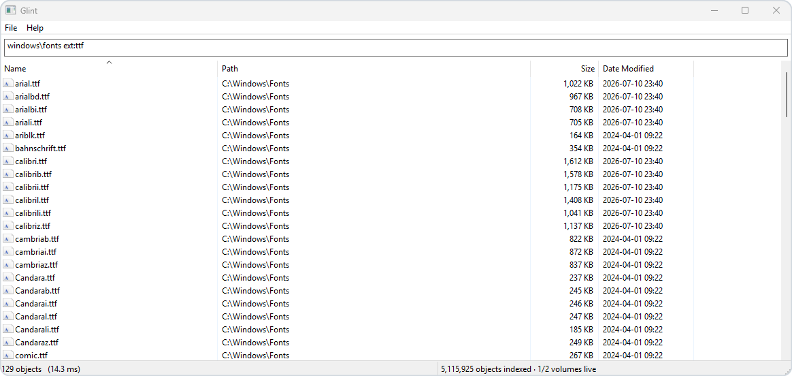
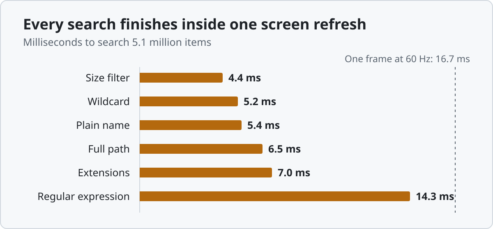
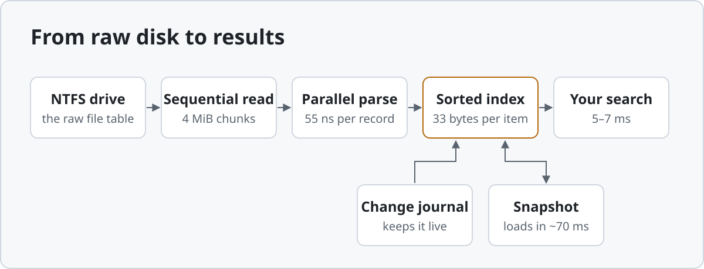

<p align="center">
  
</p>

<h3 align="center">Find any file on your Windows PC before you finish typing.</h3>

<p align="center">
  <a href="#speed"><b>Speed</b></a> &nbsp;·&nbsp;
  <a href="#what-you-get"><b>Features</b></a> &nbsp;·&nbsp;
  <a href="#get-started"><b>Get started</b></a> &nbsp;·&nbsp;
  <a href="#search-syntax"><b>Search syntax</b></a> &nbsp;·&nbsp;
  <a href="#how-it-works"><b>How it works</b></a>
</p>

<p align="center">
  
</p>

## Speed

<p align="center">
  <picture>
    <source media="(prefers-color-scheme: dark)" srcset="docs/speed-dark.svg">
    <source media="(prefers-color-scheme: light)" srcset="docs/speed-light.svg">
    
  </picture>
</p>

<p align="center"><sub>Median of 7 runs on a real PC with 5.1 million items on 2 drives (Intel i5-13600KF, NVMe SSD).</sub></p>

<table>
<tr><th align="left" colspan="2">Time</th><th align="left" colspan="2">Memory and disk</th></tr>
<tr><td>Start, index ready</td><td align="right"><b>~80 ms</b></td><td>Hidden in the tray</td><td align="right"><b>0.2 MB</b></td></tr>
<tr><td>Open the window</td><td align="right"><b>~105 ms</b></td><td>Searching, index loaded</td><td align="right"><b>172 MB</b></td></tr>
<tr><td>Reopen a running window</td><td align="right"><b>25 ms</b></td><td>Index saved on disk</td><td align="right"><b>170 MB</b></td></tr>
<tr><td>Export every file to CSV</td><td align="right"><b>1.1 s</b></td><td>Size of each program</td><td align="right"><b>1.7 MB</b></td></tr>
<tr><td>Full index, folder walk</td><td align="right"><b>4.7 s</b></td><td>Runtime to install</td><td align="right"><b>none</b></td></tr>
<tr><td>Full index, as admin</td><td align="right"><b>11–12 s</b></td><td colspan="2"></td></tr>
</table>

## What you get

<table>
<tr>
<td width="50%" valign="top"><b>Results as you type</b><br>Every keystroke searches the whole index and answers in name order.</td>
<td width="50%" valign="top"><b>Always current</b><br>Run as admin and Glint follows the NTFS change journal. New, renamed and deleted files show up by themselves.</td>
</tr>
<tr>
<td valign="top"><b>Nothing hidden</b><br>Each hard link is its own result, and alternate data streams are searchable, like <code>report.pdf:Zone.Identifier</code>.</td>
<td valign="top"><b>Folder sizes built in</b><br><code>folder: size:>10gb</code> shows what is filling a disk, with totals kept exact on every change.</td>
</tr>
<tr>
<td valign="top"><b>Almost no memory when hidden</b><br>Glint frees its index 3 seconds after the window closes and reloads it in about 50 ms.</td>
<td valign="top"><b>Every drive, even offline</b><br>USB and removable drives are indexed, and you can search a copied <code>$MFT</code> from another machine.</td>
</tr>
</table>

## Get started

You need 64-bit Windows 10 or 11 and [Rust](https://rustup.rs) with the MSVC toolchain, which the Rust installer sets up. There are no prebuilt downloads yet.

```bash
git clone https://github.com/Sepinz/glint
cd glint
cargo build --release
```

Run `target\release\glint.exe` and start typing. Choose **File → Restart as Administrator** to read drives directly and turn on live updates.

| Key | Action |
|---|---|
| <kbd>Enter</kbd> or double-click | Open the file |
| <kbd>Ctrl</kbd>+<kbd>C</kbd> | Copy its path |
| Right-click | Open, open the containing folder, or copy the path or name |
| <kbd>Ctrl</kbd>+<kbd>F</kbd> | Jump to the search box |
| <kbd>F5</kbd> | Rebuild the index |
| <kbd>Ctrl</kbd>+<kbd>Alt</kbd>+<kbd>Space</kbd> | Show or hide Glint from anywhere |

Closing the window keeps Glint in the tray. **File → Exit** or the tray menu quits. `glint.exe --tray` starts it hidden, which is useful at sign-in.

<details>
<summary><b>Command line</b></summary>

```text
glint-cli.exe [-n N] [-s name|path|size|date] [-r] [-c] [-l] [-f csv|tsv|json] [--reindex] [--db PATH] QUERY
glint-cli.exe --mft copy-of-MFT.bin [--as C] QUERY
```

The index is saved at `%LOCALAPPDATA%\Glint\index.db`. Set `GLINT_DB` to move it.

</details>

## Search syntax

| Type | To find |
|---|---|
| `foo bar` | names with both words |
| `!tmp` | names without `tmp` |
| `jpg\|png` | either word |
| `"two words"` | an exact phrase |
| `*.rs` &nbsp; `a?c.*` | wildcards on the whole name |
| `windows\fonts` | a match on the full path |
| `ext:jpg;png` | these extensions |
| `file:` &nbsp; `folder:src` | only files, or only folders |
| `size:>10mb` | by size, in `b` `kb` `mb` `gb` `tb` |
| `dm:today` &nbsp; `dm:7d` &nbsp; `dm:2024-05` | by date modified |
| `attrib:hs` | hidden and system (`h` `s` `r` `l`) |
| `depth:<=2` | by folder depth |
| `len:>100` | by name length |
| `parent:c:\temp` | directly inside a folder |
| `regex:^a.*z$` | a regular expression |

Searches ignore case. `size:` on a folder compares its total size.

## How it works

<p align="center">
  <picture>
    <source media="(prefers-color-scheme: dark)" srcset="docs/flow-dark.svg">
    <source media="(prefers-color-scheme: light)" srcset="docs/flow-light.svg">
    
  </picture>
</p>

<details>
<summary><b>Why it is this fast</b></summary>

| Technique | Where |
|---|---|
| Reads the raw `$MFT` in 4 MiB chunks with a double-buffered reader thread, skipping ranges the MFT bitmap marks unused | `src/ntfs.rs` |
| Parses records off the I/O thread and builds them in order | `src/mft.rs` |
| Catches up from the USN change journal at start, then blocks on it for live updates | `src/usn.rs`, `src/engine.rs` |
| Formats list rows only when they are painted | `src/bin/glint/list.rs` |

- **Compact index:** about 23 bytes of fixed data per file, with names in one UTF-8 arena.
- **Sorted by name in memory:** searches read arrays sequentially and results arrive already sorted.
- **Equal names stored once:** `index.js` and `README.md` take the space of one copy, and each distinct name is tested once.
- **Flat snapshot:** a warm start reads straight into the final allocations, then validates them.
- **Parallel search:** rayon with SIMD `memchr` matching, and stale queries are cancelled.
- **Incremental typing:** extending a plain query only filters the previous results.
- **Regex filter:** names missing the text a pattern requires never reach the regex engine.
- **No extra fields:** folder totals and file attributes live in space the index already had.

</details>

<details>
<summary><b>Limitations</b></summary>

- Alternate data streams come from the `$MFT`, so they need an admin run. The internal `WofCompressedData` stream is always skipped.
- Without admin rights, Glint walks folders and refreshes in the background when the index is over 30 minutes old. Folder totals are only as fresh as that refresh.
- FAT, exFAT and ReFS drives are indexed by folder walk and do not update live.
- Drives without an active USN journal are indexed but do not update live. Glint never creates or changes a journal.
- An `$MFT` that is itself split across an attribute list is extremely rare. That drive falls back to the folder walk.
- The folder walk follows OneDrive placeholders but never junctions or symlinks.
- `dm:` uses the UTC offset at the start of each hour, so zones with half-hour daylight shifts can be off by 30 minutes for that hour in exports.

</details>

---

<p align="center"><sub><a href="LICENSE">MIT licensed</a></sub></p>
